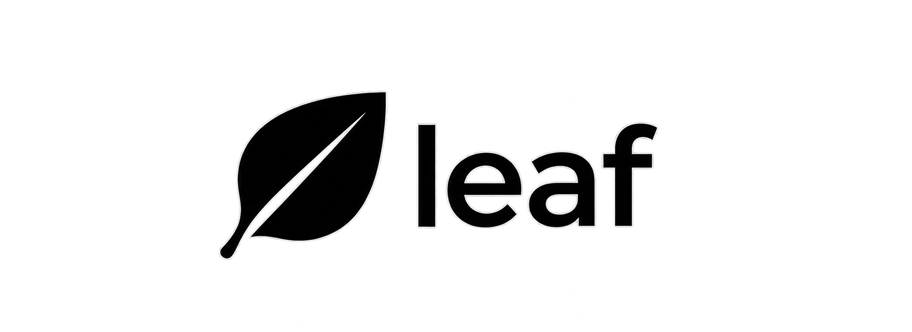

# Leaf

Leaf is a social journal and media server written in Lean 4 (`v4.37.0-rc1`). It runs on a custom log-structured database, a content-addressed object bucket, a shared transaction manager, and machine-checked storage proofs, with no C/C++ shims, FFI, or external database engines.

## Running locally

```sh
lake build
lake exe leaf
```

Open [http://127.0.0.1:8080/](http://127.0.0.1:8080/) to create, edit, delete, and paginate entries with JPEG, PNG, WebP, or GIF images up to 10 MiB. The built-in architecture guide is at [http://127.0.0.1:8080/docs](http://127.0.0.1:8080/docs).

If `data/posts.db` and `data/images/` already exist from an older version, Leaf migrates those entries into the binary WAL and pack segments on first startup and leaves the legacy files untouched as a read-only backup.

## Storage layout and durability

```text
data/
├── database/
│   ├── manifest.bin          # Tracks the latest checkpoint and active WAL file
│   ├── wal/
│   │   └── wal-000001.bin    # Append-only transaction logs
│   └── checkpoints/
│       └── checkpoint-000001.bin
└── bucket/
    ├── manifest.bin          # Tracks the active pack file and byte offset
    └── segments/
        └── pack-000001.bin   # 16 MiB append-only image pack files
```

Lean's `IO.FS.Handle` does not expose arbitrary-offset `seek` or OS `fsync`, so every write is a sequential append followed by `flush`. Manifests, checkpoints, and crash-recovery tail truncations write to a temporary file first and swap it into place with `IO.FS.rename`. Object reads either hit the bounded in-memory segment cache (`segmentCacheCapacity = 4`, 16 MiB segments) or skip forward `offset` bytes before reading the frame.

On startup, Leaf loads the latest checkpoint and scans the active WAL and pack segments from start to finish. Frame CRC32 checksums, SHA-256 and byte-equality checks, uncommitted-transaction filtering, and tail truncation protect against mid-write process crashes and corrupted tails. Because `IO.FS.Handle.flush` only flushes user-space buffers without `fsync` or directory sync, sudden hardware power loss can still drop recently flushed writes.

Post mutations and image allocations share one `Std.Mutex`-coordinated WAL (`beginTx`, `allocObject`, `putPost`, `updatePost`, `deletePost`, `incRef`, `decRef`, `commitTx`, `abortTx`). Readers run inside `withSnapshot`, which pins referenced `ObjectKey` values so concurrent maintenance cannot delete images while a request is reading them.

## Maintenance operations

Three manual actions on the home page (or via `POST /admin/{checkpoint,gc,compact}`) keep disk usage bounded:

- **Checkpoint** writes a clean snapshot of all current posts and tombstones to a temporary file, flushes it, renames it into place, and rotates to a fresh empty WAL so future restarts replay less history.
- **GC** removes unreferenced images from the live bucket index while respecting active reader snapshot pins.
- **Compact** clears deleted post tombstones into a fresh checkpoint, removes superseded WAL files, and rewrites remaining live images into clean pack segments before deleting fragmented ones.

## Formal verification and tests

Proofs in `Leaf/Core/` verify the executable storage logic directly against its invariants without `sorry`, `admit`, custom axioms, or `native_decide`:

- Cryptography and framing (`Leaf/Core/Crc32.lean`, `Leaf/Core/Sha256.lean`, `Leaf/Core/Codec.lean`, `Leaf/Core/Frame.lean`): codec prefix-roundtrip proofs, frame CRC/EOF/version error proofs, and NIST SHA-256 test vectors.
- Database state (`Leaf/Core/DbModel.lean`, `Leaf/Core/WalLog.lean`): invariant preservation, read-after-write, primary-key uniqueness, descending `Pairwise` and `Nodup` feed ordering, cursor partitioning, compaction equivalence, and uncommitted WAL transaction isolation.
- Object storage and joint store (`Leaf/Core/BucketModel.lean`, `Leaf/Core/StoreModel.lean`): segment bounds safety, disjoint span allocation, deduplication and hash-collision safety, pin-aware GC soundness, and cross-engine refcount and abort isolation.

Run the axiom audit and test suites:

```sh
lake build Tests.AxiomAudit
lake build core_tests storage_tests recovery_tests app_tests
lake exe core_tests
lake exe storage_tests
lake exe recovery_tests
lake exe app_tests
```

## HTTP and JSON routes

| Route | Purpose |
| --- | --- |
| `GET /` | Server-rendered journal feed (`?cursor=<ts>:<id>&limit=<n>`) |
| `GET /docs` | In-app storage and verification documentation |
| `GET /healthz` | Health check (`ok` when store is open) |
| `GET /api/posts` | JSON paginated feed (`posts`, `nextCursor`) |
| `GET /api/posts/{id}` | JSON single post |
| `POST /posts` | Multipart create post with optional image |
| `POST /posts/{id}/edit` | Multipart update post or replace/remove image |
| `POST /posts/{id}/delete` | Delete post and decrement image refcount |
| `DELETE /api/posts/{id}` | JSON delete post |
| `GET /objects/{digestHex}/{tag}` | Content-addressed verified image stream |
| `GET /images/{id}` | Legacy image route by post ID |
| `POST /admin/{checkpoint,gc,compact}` | Manual checkpoint, GC, and compaction triggers |
